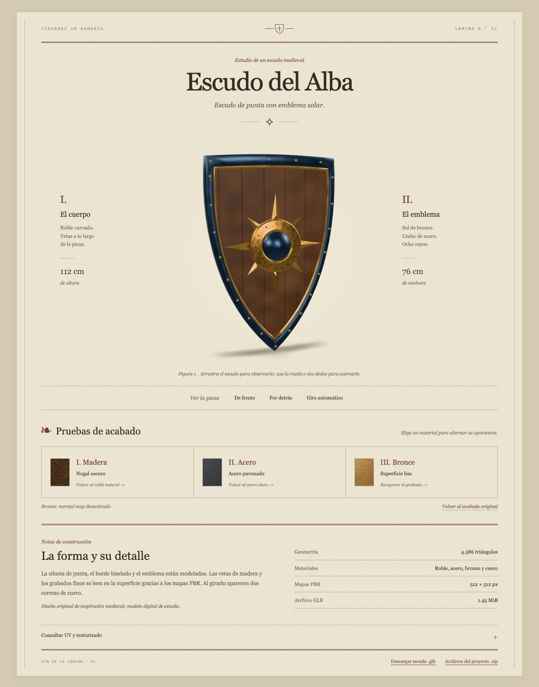

# Revisión de requisitos — Escudo del Alba

Revisión del 22 de octubre de 2026 sobre el escudo seleccionado para la entrega. **Los puntos 1 a 5 están cubiertos. El punto 6 queda pendiente.**

| Requisito | Resultado | Evidencia |
|---|---|---|
| 1. Objeto medieval con carga baja/media | Escudo de punta con emblema solar, 4.586 triángulos | Conteo del GLB y revisión visual |
| Mínimo tres materiales | 4: madera, acero, bronce y cuero | Cuatro materiales/primitivas en el GLB |
| 2. UV en todas las piezas | Todas las caras tienen UV; 0 triángulos con área UV nula | `projects/alba/source/revision-requisitos.json` y `uv-layout.png` |
| 3. PBR a 1K o 512 px | Base Color, Roughness, Metallic y Normal a 512 × 512 px | Mapas fuente e imágenes integradas |
| 4. Exportación GLB | glTF 2.0 binario, 1.518.884 bytes / 1,45 MiB | Khronos: 0 errores y 0 advertencias |
| 5. HTML con Google model-viewer | Componente real y servido desde `vendor/` | HTML y carga efectiva del modelo |
| Tres botones que cambian la apariencia | Textura roble/nogal, acero claro/pavonado, normal map del bronce activado/desactivado | Pruebas en navegador, sin errores de JavaScript |
| 6. Publicación y enlace de revisión | **Pendiente** | Código preparado en GitHub; falta verificar el despliegue en Vercel |

## UV y mapas

Las caras verticales de cantos, aros y correas usan proyección local en el plano de cada cara. Se comprobó que todas tienen área UV distinta de cero. Las piezas repetidas reutilizan deliberadamente el dominio de cada material.

Roughness y Metallic se entregan como mapas individuales. En el GLB comparten una textura: Roughness ocupa G y Metallic, B. Se verificó la coincidencia de esos canales con los mapas individuales. Madera y cuero tienen Metallic = 0; acero y bronce, Metallic = 1.

El texturizado y el relieve son procedurales: los normal maps se generan desde campos de altura. No se usó Substance Painter ni se hizo un bake de high-poly a low-poly. El formato de entrega solicitado, GLB, está incluido junto con el generador editable, los mapas y la memoria técnica.

## Archivos de verificación

Dentro de `projects/alba/`:

- `source/revision-requisitos.json`: auditoría de materiales, UV, resoluciones y controles.
- `source/validation-gltf.json`: informe Khronos del GLB actual.
- `source/uv-layout.png`: distribución UV.
- `dist/assets/model-stats.json`: estadísticas y SHA-256 del GLB.
- `source/textures/`: mapas editables.

## Página y publicación

La página abre directamente el Escudo del Alba y conserva sus tres controles de materiales, las vistas del frente y reverso, el giro y la restauración. El build de la raíz copia únicamente este proyecto a `dist/`. La publicación web en Vercel sigue pendiente; subir el repositorio a GitHub no completa por sí solo ese requisito.

## Documentación oficial consultada

- [Google model-viewer](https://modelviewer.dev/).
- [API y ejemplos de materiales](https://modelviewer.dev/examples/scenegraph/).

## Prueba de apariencia

Los cambios de madera, acero y bronce son combinables.

