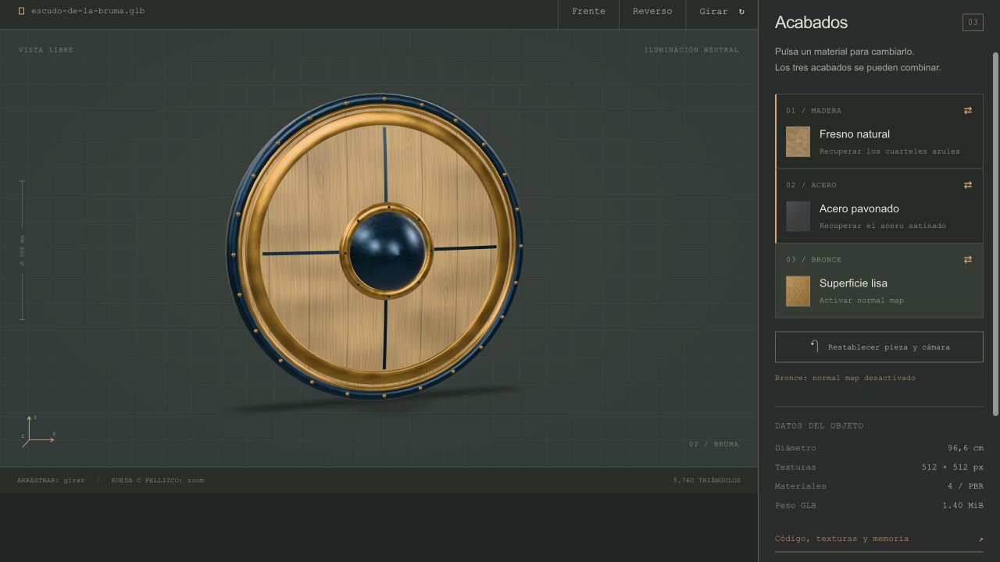

# Revisión de requisitos — Alba y Bruma

Revisión del 22 de octubre de 2026, sobre los archivos actuales, integrados en este repositorio. **Los puntos 1 a 5 están cubiertos. El punto 6 queda pendiente para la entrega final.**

| Requisito | Escudo del Alba | Escudo de la Bruma | Evidencia |
|---|---|---|---|
| 1. Objeto medieval con carga baja/media | 4.586 triángulos; silueta de punta y emblema solar | 5.760 triángulos; cuerpo circular, umbo y cenefa | Conteo directamente del GLB y revisión visual |
| Mínimo tres materiales | 4: madera, acero, bronce, cuero | 4: madera, acero, bronce, cuero | Materiales asignados a cuatro primitivas del GLB |
| 2. UV en todas las piezas | Sí; 0 triángulos con UV de área nula tras la corrección | Sí; 0 triángulos con UV de área nula tras la corrección | `source/revision-requisitos.json` y `source/uv-layout.png` |
| 3. PBR a 1K o 512 px | Base Color, Roughness, Metallic y Normal, todos a 512 × 512 px | Mismos cuatro tipos de mapa a 512 × 512 px; segundo juego de fresno natural | Se comprobaron mapas fuente e imágenes integradas |
| 4. Exportación GLB | glTF 2.0 binario, 1.518.884 bytes / 1,45 MiB | glTF 2.0 binario, 1.469.128 bytes / 1,40 MiB | Validación Khronos: 0 errores y 0 advertencias en ambos |
| 5. HTML con Google model-viewer | Componente real, servido desde `vendor/` | Componente real, servido desde `vendor/` | HTML, carga efectiva del modelo y documentación oficial |
| Tres botones que cambian el aspecto | Textura roble/nogal; acero claro/pavonado; normal map del bronce activado/desactivado | Juego PBR azul/fresno; acero satinado/pavonado; normal map del bronce activado/desactivado | Los seis controles se probaron en el navegador local, sin errores de consola |
| 6. Publicación y enlace de revisión | **Pendiente para esta versión** | **Pendiente** | Repositorio recibido; falta completar y verificar la publicación web en Vercel |

## Corrección realizada en esta revisión

La revisión detectó coordenadas UV presentes pero colapsadas en algunas caras de cantos, paredes de aros y pequeñas piezas. El validador estándar de glTF no denunciaba ese problema. Se corrigió la proyección de esas caras en ambos generadores, se regeneraron los GLB y se comprobó que ahora **todas las caras tienen área UV distinta de cero**.

No cambian el número de triángulos ni las siluetas. Las nuevas costuras UV modifican el número de vértices exportados: Alba tiene 9.981 y Bruma, 11.294. Se actualizaron estadísticas, memorias, vistas UV y ZIP. Se conserva el diseño de las páginas.

Los materiales tienen dominios separados, con reutilización deliberada en remaches y otras piezas repetidas. No se requiere un atlas global sin solapamientos ni un segundo UV de lightmap para este flujo.

## Mapas y flujo de trabajo

Roughness y Metallic también se entregan como mapas individuales. En el GLB comparten un mapa: Roughness ocupa G y Metallic, B. Se verificó que esos canales coinciden con sus mapas individuales. Madera y cuero tienen Metallic = 0; acero y bronce, Metallic = 1.

El texturizado y el relieve son procedurales: los normal maps se generan desde campos de altura. No se usó Substance Painter ni se hizo un bake de high-poly a low-poly. La consigna propone Substance/Photoshop/Blender como opciones; este proyecto documenta el proceso real usado y no incluye un archivo `.blend` o `.spp`. El formato de entrega solicitado, GLB, sí está incluido.

## Publicación pendiente

Los ZIP actuales incluyen `vercel.json` y la carpeta estática `dist`. No se ha creado un despliegue de estas versiones. La versión antigua de Alba que se publicó inicialmente con acceso privado no representa los rediseños ni los UV corregidos y no debe usarse como enlace de la entrega final. Para cerrar el punto 6 falta publicar las versiones actuales en Vercel y compartir enlaces accesibles para quien las revise.

## Archivos de verificación

En cada proyecto:

- `source/revision-requisitos.json`: auditoría de materiales, UV, resoluciones y pruebas de controles.
- `source/validation-gltf.json`: informe Khronos de los GLB actuales.
- `source/uv-layout.png`: distribución UV.
- `dist/assets/model-stats.json`: estadísticas y hash SHA-256 del GLB.
- `source/textures/`: mapas editables.

## Documentación oficial consultada

- [Google model-viewer](https://modelviewer.dev/).
- [API y ejemplos de materiales](https://modelviewer.dev/examples/scenegraph/).

## Pruebas de apariencia

Los cambios de madera, acero y bronce son combinables. Se revisaron también el reverso y la restauración de materiales.

